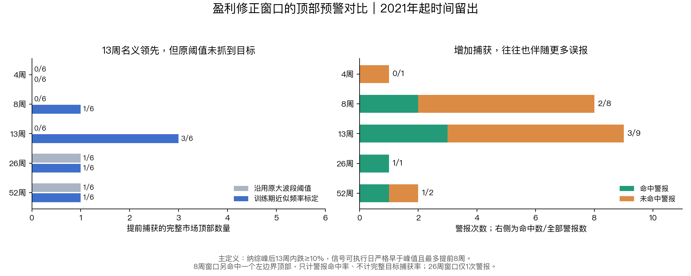
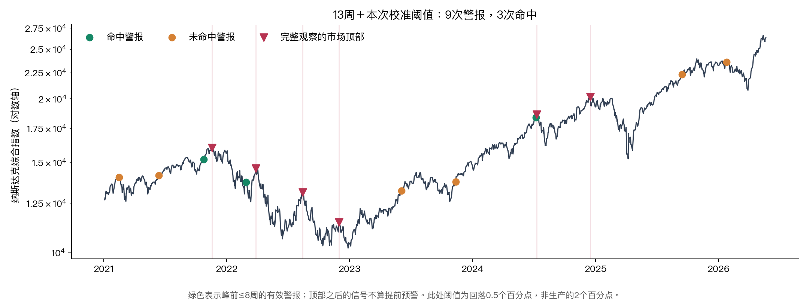

# 哪个盈利修正窗口更适合预警市场顶部？

研究日期：2026-10-19。行情截至 2026-10-16。主留出警报评价区间：2021-01-01—2026-05-22。

同日生产修复记录：实时、清洗两种口径已统一取消增长率向年初回填，以免历史计算包含当时尚未记录的信息。下文研究统计保留原研究产物；本次修复未重跑旧因子试验，也未据生产数据的重生成改写本报告回测结论。

## 结论

**没有证据证明某个窗口是可靠、稳定的“最佳抓顶窗口”。13周＋本次近似频率标定的阈值，在主检验捕获最多，但误报多、优势不显著。现行阈值的13周版本没有提前捕获本方案的6个完整目标。**

- 保留生产的上升4个百分点、峰值2%、回落2个百分点阈值，用本次因果重建数据重算，13周为 **0/6**，3次警报均未命中。
- 仅在训练期按警报频率标定阈值后，13周为 **3/6**，9次警报命中3次，误报6次，提前中位数约3.6周。其中2024年7月那次仅提前2天。
- 26周/52周警报较少，但都只抓1个目标，不能把单次成功解释为高可靠性。
- 13周捕获率的Wilson参考区间为 **18.8%—81.2%**；事件数少且可能属于同一熊市周期，该区间也不能当独立样本的强证据。
- 循环平移检验：13周单窗探索性p=0.247；允许五个窗口挑最好后p=0.333。当前优势可由历史时点巧合解释，不能称已验证的预测能力。

## 问题和检验规则

这里比较的是基础盈利修正回看窗口4/8/13/26/52周，不是二阶导菜单里的比较间隔。

1. 主目标为纳综日收盘的10%对称Zigzag顶部，且峰后13周内跌满10%；峰值由价格单独确定，不能用盈利指标挑顶部。
2. 警报必须在顶部之前、最多提前8周，才叫成功。警报产生于周五周报，保守视为下一交易日收盘才可执行。同日顶部、峰后警报不计成功。
3. 同一顶部最多匹配一个警报。重复或未对应目标的警报都算预警负担。所有窗口相同13周冷却。
4. 使用2018—2020年作频率校准段，2021年起作时间留出。阈值只按警报次数校准，不看价格结果；没有用测试段选阈值。
5. 为防越临近今天越容易把“尚未发生的跌幅”当作没有发生，主警报日截止行情末日之前21周（8周找峰＋13周确认跌幅）。
6. 捕获率只计有完整8周预警机会的目标；警报命中率可计起点附近的真实成功警报。因此8周窗口捕获1/6，但警报命中2/8：多出的一个是2021-02-12的左边界顶部。

该方法的时间切分原则参照 [scikit-learn 时间序列验证说明](https://scikit-learn.org/stable/modules/generated/sklearn.model_selection.TimeSeriesSplit.html)；多窗口择优须考虑多重尝试，参见 [Harvey、Liu、Zhu 的研究](https://www.nber.org/papers/w20592)。这些文献支持验证原则，不能替代本数据的实证结果。

## 先修正原“实时口径”的信息时间

本研究建立时，原 `analyze.next_growth` 会把当年首次记录的明年增速向前补到年初，`realtime.signals` 也使用它，因此当时不能直接用生产 `_weekly_rt.csv` 来证明历史上可提前预警。该增长率回填已于 2026-10-19 在实时、清洗两种生产口径中统一取消：只使用当周及此前已记录值，按记录所在周五生效并向后沿用。

本研究逐周截断周报，只用当时已有记录重新调用 `guard`；增长率只向前沿用。源记录筛选自 2016 年起，首个可用增长率记录为 2016-09-09，此前为空；生产实时、清洗两组 13 周纯修正均已重算核实从 2016-12-02 起可用。本研究所有窗口共同特征起点为 2017-09-01。“首个记录”不等于供应商首次对外公开。

跨年沿用旧增速仍只是时间滚动扣除近似，因为预测目标年度改变，并未新增历史证据。为此另做原始EPS变化、不扣滚动的对照。原始EPS对照下，窗口排名及命中并不稳定。这里保存的是周报重建结果，并非完备的供应商逐日历史版本数据库。生产本次修复未改 EPS 清洗、插值及实时待核实防护，也未改旧 `x13_excess` 的 `baseline` 补值，不能据此把清洗口径称为完全无前视。

## 保留现行阈值，只换窗口

这张表回答“仅把13周改成其他窗口，是否就能更好抓顶”。阈值全部保持4/2/2个百分点，但长短窗口幅度本来就不同，因此它是生产兼容性对照，不能作为公平选窗的唯一依据。

| 基础窗口 | 捕获完整顶部 | 命中警报/全部警报 | 警报命中率 |
| --- | --- | --- | --- |
| 4周 | 0/6 | 0/1 | 0.0% |
| 8周 | 0/6 | 0/2 | 0.0% |
| 13周 | 0/6 | 0/3 | 0.0% |
| 26周 | 1/6 | 1/1 | 100.0% |
| 52周 | 1/6 | 1/1 | 100.0% |

**结果不支持仅换窗口即可解决预警问题。** 长窗口的单个命中也非常晚：26周约提前2.6周，52周约提前0.6周。

## 尽量对齐训练期警报频率

统一乘c缩放三个阈值，保留4:2:2的比例。c只从预先固定的8个值中选择，目标约每年一次；并列取更大的c。训练次数实际为2/3/3/1/2，并没有完全同频；留出期也变为1/8/9/1/2。故必须同时看捕获和误报。

| 基础窗口 | 训练警报数 | 阈值倍数c | 捕获完整顶部 | 命中警报/全部警报 | 警报命中率 | 误报/年 | 领先中位数 |
| --- | --- | --- | --- | --- | --- | --- | --- |
| 4周 | 2 | 1.0 | 0/6 | 0/1 | 0.0% | 0.19 | — |
| 8周 | 3 | 0.5 | 1/6 | 2/8 | 25.0% | 1.11 | 4.14周 |
| 13周 | 3 | 0.25 | 3/6 | 3/9 | 33.3% | 1.11 | 3.57周 |
| 26周 | 1 | 2.0 | 1/6 | 1/1 | 100.0% | 0.00 | 1.57周 |
| 52周 | 2 | 0.5 | 1/6 | 1/2 | 50.0% | 0.19 | 3.57周 |

**重要：13周c=0.25，对应上升1个百分点、峰值0.5%、回落0.5个百分点。这不是当前页面的生产阈值。** 不能把这张表的3/6归功于现行13周模型，也不应据此直接把生产阈值放宽四倍。

## 每个市场顶部到底有没有提前提示

| 市场顶部 | 跌满10%确认日 | 4周窗口 | 8周窗口 | 13周窗口 | 26周窗口 | 52周窗口 |
| --- | --- | --- | --- | --- | --- | --- |
| 2021-11-19 | 2022-01-19 | — | — | 2021-10-25（提前25天） | 2021-11-08（提前11天） | 2021-10-25（提前25天） |
| 2022-03-29 | 2022-04-22 | — | 2022-02-28（提前29天） | 2022-02-28（提前29天） | — | — |
| 2022-08-15 | 2022-09-01 | — | — | — | — | — |
| 2022-12-01 | 2022-12-28 | — | — | — | — | — |
| 2024-07-10 | 2024-08-02 | — | — | 2024-07-08（提前2天） | — | — |
| 2024-12-16 | 2025-03-06 | — | — | — | — | — |

五个窗口全部漏掉2022-08-15、2022-12-01、2024-12-16。对纳斯达克100复核时，最后一个大跌前顶部为2025-02-19，仍未被捕获。2022年的多个顶部属于同一熊市过程，不能视为完全独立的统计证据。

## 稳健性：结论对什么敏感？

### 给慢跌更多时间

主定义要求13周内跌满10%，会漏掉2023年7月、2025年10月之后的较慢下跌。首轮计算后追加26周跌幅确认，明确仅作完整性附表；原参数不重新选择。对应主警报截止日变为2026-02-20。

| 窗口 | 完整顶部捕获 | 命中警报/全部警报 |
| --- | --- | --- |
| 4周 | 0/8 | 0/1 |
| 8周 | 3/8 | 4/8 |
| 13周 | 5/8 | 5/9 |
| 26周 | 1/8 | 1/1 |
| 52周 | 1/8 | 1/2 |

13周捕获最多仍成立，但对同样9次警报，精确率从33.3%变为55.6%，显示“顶部”标签本身对结果影响很大。不能把附表较好的数字替换预先指定的主结果。

### 更大的15%下跌、换指数、换时期

- 15%大跌：纳综主标签只有3个完整目标，13周抓到2个；纳指100只有4个，13周也抓到2个。延长确认期后仍漏掉2022年8月和2025年大跌前对应顶部。
- 纳指100的主10%检验总体捕获数与纳综一致，未产生足以支持新窗口的独立证据。两指数高度相关，本来也不能当成两份独立样本。
- 2023年起的严格主标签：13周只有1/2，5次警报只命中1次（20%）。慢跌标签则明显改善，因此近期样本也不足以说明“稳定最优”。
- 剔除2022年警报、目标及观察年数后，13周2/3，但警报仍有8次；捕获不再靠2022一个年份，误报问题仍在。

### 换成固定8周差分转弱

该附表仍比较同样的五个基础窗口，只把触发从“大波段折返”改为固定8周差分由正状态翻为负状态，阈值仍仅按训练频率标定。

| 基础窗口 | 固定8周差分转弱：顶部捕获 | 命中警报/全部警报 |
| --- | --- | --- |
| 4周 | 1/6 | 1/4 |
| 8周 | 2/6 | 2/4 |
| 13周 | 2/6 | 2/7 |
| 26周 | 0/6 | 0/1 |
| 52周 | 1/6 | 1/3 |

触发规则一变，8周在警报精确率上可以超过13周，但捕获仍少。这说明基础窗口不是唯一决定因素；不能跨附表再选一个最好看的组合。

### 少一个市场事件，赢家会不会变

下表按固定参数、留一完整顶部后的事件F1（兼顾捕获率与警报精确率）比较；不重新拟合阈值。

| 剔除的顶部 | 剩余事件F1最高的窗口 |
| --- | --- |
| 2021-11-19 | 13周 |
| 2022-03-29 | 26周 |
| 2022-08-15 | 13周 |
| 2022-12-01 | 13周 |
| 2024-07-10 | 26周 |
| 2024-12-16 | 13周 |

删掉一个顶部就可能改成26周第一，名次不够稳健。F1本身也只是其中一种权衡，不能代替用户对漏报与误报成本的选择。

## 对现有模型的实际含义

1. **暂时没有论据支持把基础窗口改成某个“更准的抓顶窗口”。** 13周可以继续作为季度尺度的盈利周期观察，但顶部预警能力未获可靠验证。
2. 若后续继续研究，8—13周可作为有限候选范围；应先固定对误报和提前量的要求，再做真正新增数据的前瞻记录。不要扩大参数扫描来追逐本段历史的最佳名次。
3. 本研究最初没有更改生产页面、阈值或数据更新流程，增长率回填问题当时只在研究数据中隔离。随后于 2026-10-19，生产实时、清洗两种口径已取消该回填；本报告保留原研究结果，不把生产修复或跨年沿用解释为新增历史证据，也未据此次修复重跑旧因子试验、重新论证旧回测结论。

## 可复现文件

- [预先方案及审查补充](protocol.md)
- [研究脚本](run_study.py)；运行：`python3 window_study/run_study.py`
- [报告和作图脚本](make_report.py)
- [全部汇总CSV](summary.csv)
- [逐顶部明细](top_events.csv)、[逐警报明细](warning_events.csv)
- [逐周当时可知特征](asof_features.csv)、[完整JSON与输入哈希](results.json)

本报告是对既有指标的回顾性检验，不是已经证明可获利的交易策略；未计算交易成本、现金收益或实际择时组合表现。
